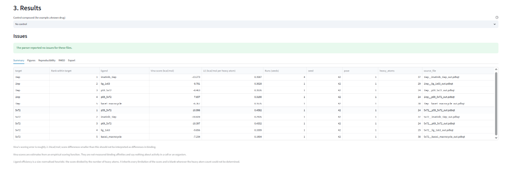

# Vina Docking Results Analyser

Turns AutoDock Vina output files into tables, figures and a methods paragraph you can
check, cite and reproduce. Upload the output PDBQT files and logs from your docking runs.
The app ranks ligands within each target, compares them against a control, summarises
repeat runs with different seeds, computes a redocking RMSD against a crystal pose, and
exports everything, with a record of exactly which files and code produced it.

It is a small, careful tool for one job. It does not run docking, prepare structures,
or judge whether your docking protocol was appropriate.



## Read before interpreting any number

These are the same limitations the app shows at the top of every page:

- **A docking score is not a binding affinity.** Vina scores are estimates from an empirical scoring function, not measured affinities, and say nothing about activity in a cell or an organism.
- **The receptor is rigid.** Protein flexibility, water molecules and changes in protonation are not modelled.
- **No comparison across targets.** Scores are ranked and compared only within one target, grid box and scoring function, never across targets.
- **Vina's scoring error is roughly 2–3 kcal/mol.** Smaller differences between ligands should not be read as differences in binding.
- Scores are not comparable across different scoring functions or very different grid boxes.

## Install and run

You need Python 3.11 or newer. Continuous integration runs the tests on 3.11, 3.12 and 3.14
on Linux, and on 3.14 on Windows.

Windows (PowerShell):

```powershell
git clone https://github.com/fahadriazkiani/vina-analyser.git
cd vina-analyser
python -m venv .venv
.venv\Scripts\Activate.ps1
pip install -r requirements.txt
streamlit run app.py
```

macOS and Linux:

```bash
git clone https://github.com/fahadriazkiani/vina-analyser.git
cd vina-analyser
python3 -m venv .venv
source .venv/bin/activate
pip install -r requirements.txt
streamlit run app.py
```

The app opens at http://localhost:8501. Press **Load example dataset** to try it on the
26 real Vina 1.2.5 files in `vina_test_data/` (see [its README](vina_test_data/README.md)).

## Input files

Upload the output PDBQT files and the logs (Vina's captured stdout), as loose files or
as one `.zip`. The target, ligand and seed are read from the file names:

```
<target>__<ligand>[_seedN]_out.pdbqt
<target>__<ligand>[_seedN].log
```

for example `1iep__imatinib_1iep_seed2_out.pdbqt` and `1iep__imatinib_1iep_seed2.log`.
A PDBQT and a log with the same target, ligand and seed are one run. Either can be
missing: a log alone gives scores without coordinates, and a PDBQT alone gives no
header values (Vina version, exhaustiveness, grid box) for the methods paragraph.

Files whose names don't follow this pattern are listed with blank names. Type the target
and ligand in the table, or untick **include**. Below the table, **Runs that will be
analysed** shows each run as the analysis will see it: the seed used and where it came
from (the log header wins over the file name), and which PDBQT is paired with which log.
That table is recomputed after every edit.

Limits: 50 MB per file, 2000 files and 200 MB in total, loose or zipped.

## What you get

- **Summary.** The best pose of each ligand on each target, its rank within that target,
  ligand efficiency (score per heavy atom), and the difference from a control you choose.
  Ties share a rank. Δ is left blank where the control was docked in a different grid box.
- **Figures.** A heatmap of best scores (one row per target), ranked bars per target
  with the control highlighted, and a strip plot of every pose per ligand. Each figure
  comes with a caption. They are colour-blind safe (Okabe–Ito), 300 dpi PNG and SVG, and
  byte-identical every time they are drawn.
- **Reproducibility.** Mean, SD (from three runs) and range of the best score across seeds.
- **RMSD.** Heavy-atom RMSD of every pose against a reference ligand pose, after you
  confirm that the reference is an experimental structure. Atoms are matched in file
  order; there is no superposition or symmetry correction, so only PDBQT references are
  accepted.
- **Export.** `results.xlsx` (one sheet per table, with a Read me sheet), CSVs that Excel
  opens correctly, `methods.txt`, `run_metadata.json`, the figures, and one
  `vina_results.zip` containing all of them.

`methods.txt` is a draft methods paragraph built only from values in the logs. Anything
the logs don't record says "not recorded" rather than a guessed default. It always
states that ligand and receptor preparation must be described separately, because Vina
logs don't record it. `run_metadata.json` records the SHA-256 of every input file, the
names each file was analysed as, the package versions, and the git commit of this code.

## Privacy

Uploaded files are processed in memory and never written to disk. Nothing is kept after
your session ends, except a temporary in-memory cache of parsed results and figures
that expires within an hour. If you use a public deployment of this app, anyone with
the link can use it, but other users cannot see your files or results. For unpublished
or confidential results, run it on your own computer as above. The app shows the same
statement next to the uploader.

## Security

The app never runs uploaded content: files are only read as text. Zips are refused
when they contain unsafe paths (`..`, absolute paths, drive letters), are encrypted,
contain two files with the same name, or unpack to more than the limits above, judged
by the actual unpacked size rather than the size the zip claims. Text that a
spreadsheet would treat as a formula (starting with `=`, `+`, `-`, `@`, tab or carriage
return) is stored as plain text in Excel and prefixed with `'` in CSV. Streamlit's XSRF
protection stays on, and usage statistics are off.

## Deploying on Streamlit Community Cloud

1. On [share.streamlit.io](https://share.streamlit.io), choose **Create app** and select
   this repository, branch `main`, and main file `app.py`.
2. Under **Advanced settings**, choose **Python 3.12**.
3. Deploy. `requirements.txt` and `.streamlit/config.toml` (upload limit, theme) are
   picked up automatically.

Notes:

- A public deployment can be reached by anyone with its link. The privacy statement in
  the app says so.
- Community Cloud apps have limited memory. The 200 MB total limit is generous for Vina
  outputs, which are tens of kilobytes each. If many people will use a shared
  deployment, lower `MAX_TOTAL_BYTES` in `vina_analyser/inputs.py`.
- The git commit recorded in the methods paragraph and `run_metadata.json` is read from
  `.git` when the `git` command is not available. Whether the deployed code had
  uncommitted changes is then unknown, and is recorded as `null`.

## How to cite

If you use results from this tool, cite AutoDock Vina:

- Eberhardt J, Santos-Martins D, Tillack AF, Forli S. AutoDock Vina 1.2.0: New Docking
  Methods, Expanded Force Field, and Python Bindings. *J. Chem. Inf. Model.* 2021.
  [doi:10.1021/acs.jcim.1c00203](https://doi.org/10.1021/acs.jcim.1c00203)
- Trott O, Olson AJ. AutoDock Vina: improving the speed and accuracy of docking with a
  new scoring function, efficient optimization and multithreading. *J. Comput. Chem.*
  2010. [doi:10.1002/jcc.21334](https://doi.org/10.1002/jcc.21334)

To cite this analyser, use the version and commit in your `methods.txt`. GitHub's
**Cite this repository** button uses [CITATION.cff](CITATION.cff).

## Testing

```bash
pytest
python scripts/mutation_runner.py --check
```

The tests run on every push (GitHub Actions; Linux with Python 3.11, 3.12 and 3.14,
and Windows with 3.14). `scripts/mutation_runner.py` plants deliberate bugs one at a
time and checks that a specific test catches each one; see PROGRESS.md. A few things
are checked by hand, such as dragging files into the uploader and editing cells in
the table. They are listed in PROGRESS.md.

## How this was built

I'm a Medical Laboratory Sciences graduate from Lahore, Pakistan, working in
computational biology. During my undergraduate thesis I docked 36 compounds and
2 control drugs against 4 targets — 152 docking runs — and did all the
bookkeeping by hand: reading scores out of log files, pasting them into
spreadsheets, redrawing the same figures every time something changed. It
worked, but six months later I could not have reproduced it exactly, and nobody
else could have either. This tool is what I wish I'd had then.

It was built with AI assistance (Claude Code) across six phases: parsing,
analysis, figures, the web app, exports, and polish. Every phase began with a
written plan I approved before any code was written, and tests were written
before the implementation each time.

Nothing here is accepted because it looks right. Every number the tool produces
is tested against real AutoDock Vina 1.2.5 output with known values, and the
test suite is itself checked: 100 deliberate bugs are planted into copies of the
code to confirm the tests actually catch them (`scripts/mutation_runner.py`).
Tests run on Python 3.11–3.14 on Linux and Windows.

The constraints the tool enforces are documented as explicit decisions in
`PROGRESS.md`, each made deliberately rather than inherited from a default:
CG0 glue carbons count as heavy atoms while G0 pseudo-atoms do not; scores are
never compared across targets; redocking RMSD is refused unless the reference is
explicitly confirmed as an experimental pose; and every output carries the
caveat that Vina's scoring error is roughly 2–3 kcal/mol.

I used AI assistance for implementation and for code review. The requirements,
the scientific constraints, and the final judgement on what was acceptable
were mine.

## Licence

MIT, © 2026 Fahad Riaz. See [LICENSE](LICENSE). The prepared input structures in
`vina_test_data/` come from the AutoDock Vina repository and remain under the Apache
License 2.0 ([LICENSES/Apache-2.0.txt](LICENSES/Apache-2.0.txt)).
